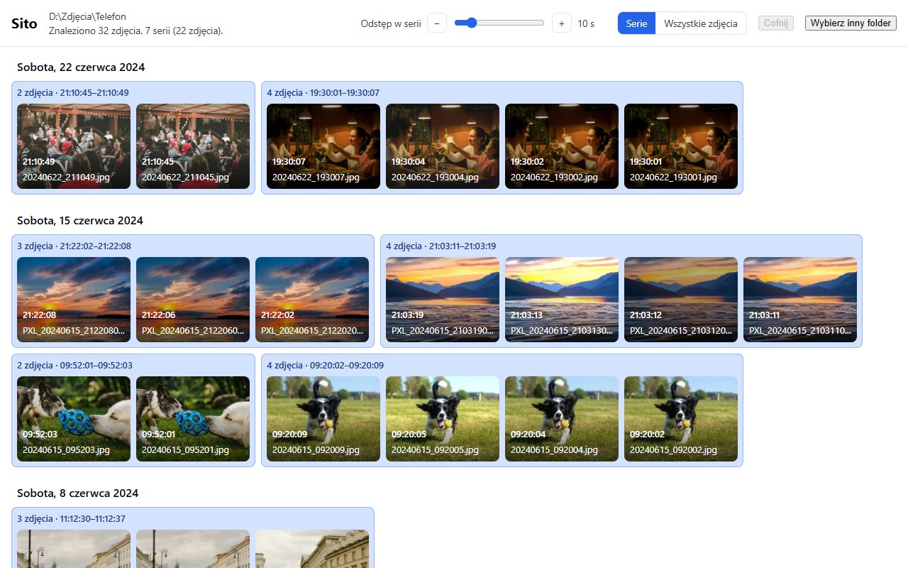
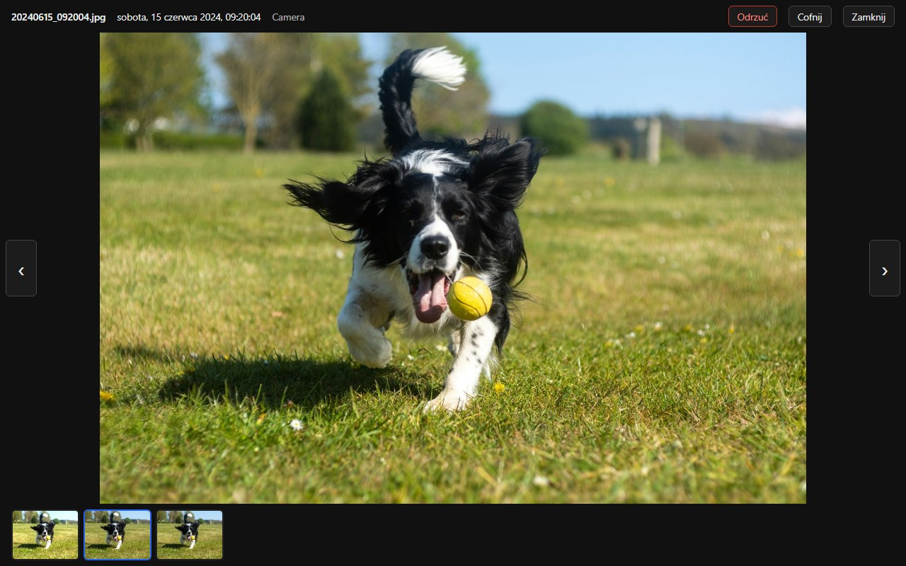

# Sito

Desktop app that finds series of similar photos in a large gallery and suggests the best shot of each series. Everything runs locally and offline; the app only suggests, you decide.

<picture>
  <source media="(prefers-color-scheme: dark)" srcset="docs/images/timeline-dark.jpg">
  
</picture>

## What it does today

- **Finds series:** photos taken a few seconds apart form a series; a slider sets the gap.
- **Timeline:** all photos by day, with series framed together, fast even with tens of thousands of photos.
- **Viewer:** compare the shots of a series one by one, with a strip of the whole series and keyboard shortcuts.
- **Reject with undo:** rejected photos are moved into an "Odrzucone" folder, never deleted, and every move can be undone.
- **Fast rescans:** results are cached, so reopening a folder only reads new or changed photos.
- **JPEG, RAW and TIFF:** `.orf`, `.cr2`, `.nef`, `.arw`, `.rw2`, `.raf` and `.dng` are shown by their embedded previews, a RAW+JPEG pair is one photo; TIFF scans are converted for viewing.

Picking the best shot of each series automatically (sharpness, exposure, faces) is planned, see the [roadmap](docs/ROADMAP.md). The UI is in Polish for now.

<picture>
  <source media="(prefers-color-scheme: dark)" srcset="docs/images/viewer-dark.jpg">
  
</picture>

Built with Tauri (Rust) and React + TypeScript. See [CLAUDE.md](CLAUDE.md) for architecture, conventions and commands.

## Google Takeout

Photos exported with [Google Takeout](https://takeout.google.com) keep their real dates in JSON files next to each photo, also when the photo itself has none or a wrong one (WhatsApp images, scans dated in Google Photos). Sito reads these dates. Unpack all Takeout zips into one folder on a drive with enough space (the archive is as large as the zips), then open its `Takeout/Google Photos` folder (localised, e.g. `Takeout/Zdjęcia Google`). Sito cannot read the zips directly.

## Quick start

```bash
npm install
npm run tauri dev
```

Requirements: Rust (stable), Node.js 24 LTS, and on Windows the MSVC Build Tools and WebView2.

## Photo credits

The screenshots show a demo gallery made from photos on [Unsplash](https://unsplash.com); see [the credits](docs/images/demo-gallery/SOURCES.md) and [how to regenerate the screenshots](docs/images/README.md).

## License

Licensed under either of

- Apache License, Version 2.0 ([LICENSE-APACHE](LICENSE-APACHE))
- MIT license ([LICENSE-MIT](LICENSE-MIT))

at your option. The software comes "as is", without warranty of any kind; the authors are not liable for any damages arising from its use (see the license texts).
