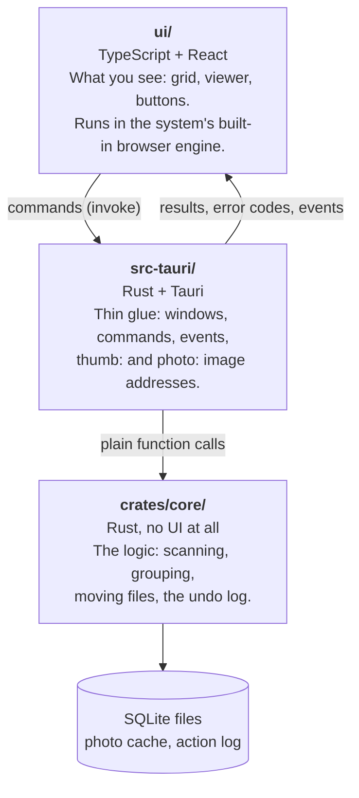
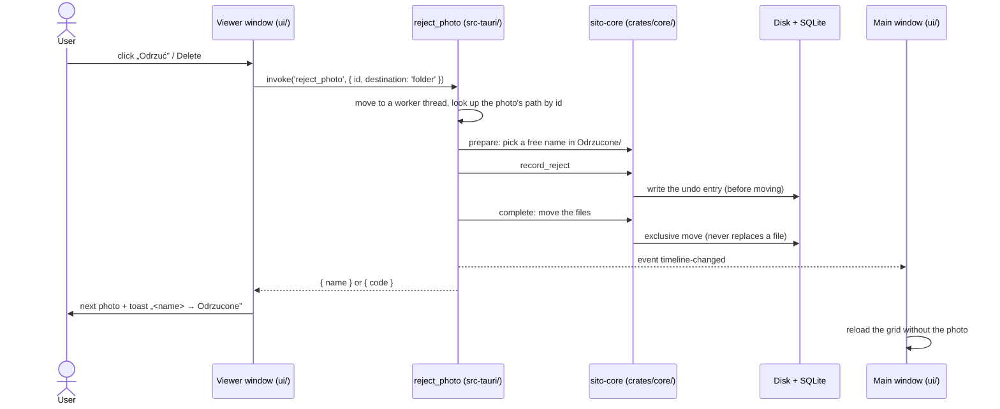

# Architecture for newcomers

This page explains Sito's technologies and parts to someone who has not worked with Rust, TypeScript or Tauri: what each one is, why it was chosen, and how a click travels through the app. The rules for writing code (layers, lints, file sizes) and the pipeline stages are in [CLAUDE.md](../CLAUDE.md); what the app does is in [docs/domain/](domain/README.md).

## The three parts

Sito is one desktop program made of three parts, each in its own folder:

- **`ui/`** draws the windows' content and reacts to clicks and keys. It knows no files or folders; it only asks the Rust side for things by photo id.
- **`src-tauri/`** turns a request from the UI into a call into `core`, runs it off the UI thread, and turns the answer (or the error) into something the UI can read. It also serves the images and tells all windows when something changed.
- **`crates/core/`** does the actual work and is tested on its own, without a window.

## The technologies and why they were chosen

### Tauri: the app frame

Tauri makes a native window, shows a web page in it, and connects that page to a Rust program running next to it. It is similar to Electron (the base of VS Code or Slack), with one big difference: Electron ships a full copy of Chrome inside every app, while Tauri uses the browser engine the operating system already has (WebView2 on Windows, WebKit on macOS).

Why: installers of a few megabytes instead of more than a hundred, and much lower memory use, which matters next to a 50 000-photo gallery on a machine with little RAM. Tauri is also locked down by default: the page can only call the commands the app declares, which helps keep photos on the machine.

### Rust: the backend language

Rust compiles to fast native code, like C or C++, but its compiler rejects whole classes of bugs: reading memory that was freed, data shared between threads without a lock, forgetting to handle an error.

Why: Sito reads tens of thousands of photos and parses file formats it cannot trust (EXIF, TIFF, RAW, Google Takeout files). That code has to be fast and must not crash or be exploitable on a damaged file. Rust gives the speed of C with far fewer of those risks, makes using all CPU cores safe, and is the language Tauri itself is written in.

### TypeScript and React: the user interface

- **TypeScript** is JavaScript with types: a mistake such as passing text where a number belongs is reported before the app runs.
- **React** builds the screen from components: functions that take data and return what to show. When the data changes, React updates only what differs.
- **Vite** serves the UI during development and reloads it instantly after an edit.

Why: web technology is the quickest way to a polished, flexible UI, and it is what Tauri displays. React is the most widely used choice, with mature libraries for what Sito needs (translations, long scrolling lists).

### SQLite: the local database

SQLite is a database stored in a single file, with no server to install. Sito keeps a photo cache (so a second scan of a folder is fast) and the action log (every rejection, so it can be undone) in it.

Why: it works offline, needs no setup, survives crashes thanks to transactions, and is compiled into the app.

## Libraries and which side they belong to

Rust libraries are called *crates* and are listed in `Cargo.toml` files; TypeScript libraries are *npm packages* and are listed in `package.json` files.

| Library | Side | What it does in Sito |
|---|---|---|
| `tauri` + plugins `dialog`, `window-state`, `log` | Rust | The app frame; folder picker; remembered window size; debug logging |
| `walkdir` | Rust | Walks through the folders of a gallery |
| `nom-exif` | Rust | Reads EXIF metadata (capture time, orientation) |
| `image`, `jpeg-decoder` | Rust | Decodes photos, also at reduced size for thumbnails |
| `blake3` | Rust | Fast hashing; builds the keys of the thumbnail cache |
| `chrono` | Rust | Dates and times without a time zone (as EXIF stores them) |
| `rayon` | Rust | Spreads work over all CPU cores |
| `rusqlite` | Rust | SQLite, with SQLite itself bundled |
| `thiserror`, `serde` | Rust | Error types; turning data into JSON for the UI |
| `ort` (planned) | Rust | Runs ML models locally (ONNX Runtime) |
| `react`, `react-dom` | TypeScript | The UI component library |
| `react-i18next` | React | Gives components the Polish texts from `ui/src/i18n/pl.json` |
| `i18next` | TypeScript | The translation engine behind it, including Polish plural forms |
| `@tanstack/react-virtual` | React | Draws only the visible rows of a long grid |
| `@tauri-apps/api` | TypeScript | Calls Rust commands and listens to Rust events from the UI |

Tools used only while developing (not shipped): Vite, Vitest and Testing Library (UI tests), Playwright (end-to-end tests), oxlint and Prettier (TypeScript checks), clippy and rustfmt (Rust checks).

## The journey of a click: rejecting a photo

The user looks at a photo in the viewer window and clicks „Odrzuć” (or presses Delete), with the folder „Odrzucone” chosen as the destination.

Step by step, with the files involved:

1. **The button or key.** `RejectButton` in [ViewerBar.tsx](../ui/src/features/viewer/ViewerBar.tsx) calls `onReject` on click. The Delete key reaches the same handler through `useShortcuts` and the key table in [keymap.ts](../ui/src/shortcuts/keymap.ts). React components only show things and pass events on; they do not talk to Rust.
2. **The UI hook.** The handler in [ViewerApp.tsx](../ui/src/features/viewer/ViewerApp.tsx) ignores a second click while one is running and calls `rejectPhoto(id, destination)`.
3. **The typed wrapper.** `rejectPhoto` in [features/reject/api.ts](../ui/src/features/reject/api.ts) is the only place that calls Tauri's `invoke('reject_photo', …)`. Tauri sends the arguments to the Rust process as JSON. Only the photo's id goes over, never its path or image data.
4. **The Tauri command.** `reject_photo` in [src-tauri/src/reject.rs](../src-tauri/src/reject.rs) moves the work off the UI thread (`off_main_thread`), so the window stays responsive. It looks up the path for the id in the current scan, checks that the file is still there, and picks the folder or trash path (`reject/folder.rs`, `reject/trash.rs`).
5. **The core logic.** In [crates/core/src/reject.rs](../crates/core/src/reject.rs), `prepare` picks a free name inside `Odrzucone` (`(2)`, `(3)` … if taken) and collects the photo's other files (its RAW twin, its Takeout date file). The command then writes the undo entry with `record_reject` in [actions.rs](../crates/core/src/actions.rs) *before* anything moves, and calls `complete`, which moves the files through the exclusive move in [reject/exclusive.rs](../crates/core/src/reject/exclusive.rs). If the move fails, the log entry is removed again and the files already moved go back.
6. **Back in the command.** The photo is taken off the in-memory timeline, and a `timeline-changed` event goes to every window. The command returns `{ name }`, or on failure an error code such as `{ code: "noTrash" }`, never an English message.
7. **Back in the UI.** The viewer shows the next photo and a toast whose text comes from `pl.json`; an error code is turned into its Polish message the same way. The main window hears `timeline-changed` (via `useTimelineRevision`) and reloads its grid, now without the rejected photo.

„Cofnij” runs the same way backwards: `undo_reject` reads the newest entry from the action log and moves the files back.

Images take a different road from commands. The grid and the viewer show photos through `thumb://` and `photo://` addresses, which the Rust side answers with image bytes: registered in [lib.rs](../src-tauri/src/lib.rs), served by `src-tauri/src/thumbnails.rs` and `src-tauri/src/viewer/photo_protocol.rs`, with shared parts in [protocol.rs](../src-tauri/src/protocol.rs). This keeps the commands small and fast.

## Where the code depends on the operating system

Most of Sito is the same on Windows and macOS. The differences sit in a few places.

**Picking the browser engine.** Sito never picks it itself. Tauri (through its `wry` library) is built against the system's engine for the target it is compiled for: WebView2 (Edge's engine) on Windows, WKWebView (Safari's engine) on macOS, WebKitGTK on Linux. On Windows the WebView2 runtime is part of Windows 11; the installer installs it if it is missing (section `WebView2` in [installer.nsi](../src-tauri/installer/installer.nsi)). Because the engines differ, a UI change is worth a look on both systems.

**Conditional compilation in Rust.** Rust marks code with `#[cfg(...)]` attributes, such as `#[cfg(windows)]` or `#[cfg(target_os = "macos")]`. Code for any other system is left out of the build entirely, so each system gets its own version of a function under the same name, and the rest of the code calls it without knowing which one it gets. Sito does this in:

| File | Windows | macOS (and Linux) |
|---|---|---|
| [core/src/reject/exclusive.rs](../crates/core/src/reject/exclusive.rs): moving a file without replacing another | `MoveFileExW` from `kernel32` | `renamex_np` with `RENAME_EXCL` (Linux: `renameat2`), through the `libc` crate; a check before a plain rename on volumes without it |
| [core/src/trash.rs](../crates/core/src/trash.rs): the system trash (`trash` crate) | move and restore | move only; macOS has no restore API yet, so „Cofnij” skips these |
| [src-tauri/src/reject/drive.rs](../src-tauri/src/reject/drive.rs): does the drive have a trash? | `GetDriveTypeW`: only fixed drives | always yes |
| [src-tauri/src/about.rs](../src-tauri/src/about.rs): the app menu | a menu bar in the window | the menu bar at the top of the screen, with the app menu macOS expects |

A system-specific dependency is declared the same way: `libc` is listed under `[target.'cfg(unix)'.dependencies]` in [crates/core/Cargo.toml](../crates/core/Cargo.toml), so Windows builds do not include it.

**Calling the system directly.** Where no crate covers a system function, the code declares it in an `unsafe extern "system"` block (`MoveFileExW`, `GetDriveTypeW`). `unsafe` marks the few lines where Rust cannot check the call itself, so they stay short and sit in these small files.

**In the UI.** The TypeScript code has no per-system branches. The one difference is the shortcut modifier: [keymap.ts](../ui/src/shortcuts/keymap.ts) treats Ctrl and Cmd alike, so Ctrl+Z on Windows is Cmd+Z on macOS.

**Packaging.** [tauri.conf.json](../src-tauri/tauri.conf.json) lists the installer types: NSIS (a per-user Windows installer with Polish text, built from `src-tauri/installer/`) and DMG/app for macOS. The [release workflow](../.github/workflows/release.yml) builds each on its own system (`windows-latest`, `macos-latest`), since an app is compiled separately for each system.

## Where to read next

- What the app does and how it behaves: [docs/domain/](domain/README.md), e.g. [Rejecting](domain/rejecting.md) for the full rules of the journey above.
- How the code must be written: [CLAUDE.md](../CLAUDE.md).
- What is being built next: [ROADMAP.md](ROADMAP.md).
